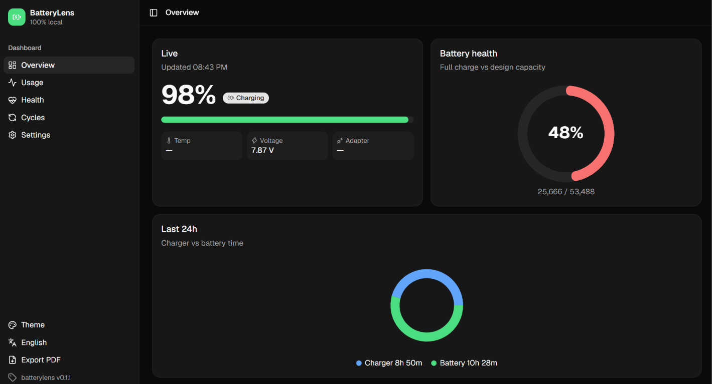

# 🔋 BatteryLens

> One command. Full battery story. Windows + macOS.

[](https://www.npmjs.com/package/batterylens)
[](https://github.com/Ashukr321/BatteryLens/actions/workflows/ci.yml)


<p align="center">
  
</p>

```bash
npx batterylens
```

BatteryLens opens a local dashboard at `http://127.0.0.1:4545` that shows how your laptop battery is really doing: health, wear, charging habits, sleep drain, screen-on time, which apps drain it, and more.

**100% local. No cloud, no telemetry, no admin rights.** Data lives in `~/.batterylens` and the server listens on `127.0.0.1` only.

---

## Install & run

No install needed. Run it with **npx** (Node.js 20+):

```bash
npx batterylens            # open the dashboard
npx batterylens install    # record history in the background (starts at login)
```

> ⚠️ Don't use `npm i batterylens`. That only adds the package to the current folder's `node_modules`, so the `batterylens` command won't be found. Use `npx batterylens`, or install globally:
>
> ```bash
> npm i -g batterylens
> batterylens
> ```

A single run shows the live state plus whatever history the OS already kept (Windows ~3 days, macOS `pmset` log). For full 24h / 30-day history, screen-on time, app usage and alerts, run `install` once.

---

## Features

### 📊 Dashboard

**Overview**
- Live card: battery %, charging / plugged / on-battery state, temperature, voltage, adapter watts. Updates every 5s over Server-Sent Events.
- Low-wattage charger warning (below 30 W, macOS)
- Battery health gauge (full-charge vs design capacity)
- 24h battery level chart, with charger-connected periods shaded
- 24h donut: charger vs battery time
- Device card: laptop model, OS, battery manufacturer / model / serial / chemistry, manufacture or first-seen date, design capacity
- Anomalies: sudden full-charge capacity drops (≥ 3% in a day) and days that drained ≥ 2× faster than usual

**Usage**
- Ranges: 24h, 7, 14 or 30 days, and any calendar month
- Totals: on charger, on battery, sleep / off, and **screen-on time** (estimate, including how much of it was on battery)
- Charger vs battery area chart with a screen-on line and a zoom brush for long ranges
- **Click any day** for a detail drawer: that day's totals, battery level and hour-by-hour split
- **Calendar heatmap** (GitHub-style) of battery hours per day
- **Sleep drain**: % lost while asleep or off and unplugged, with a warning when a sleep drains abnormally fast (> 1.5%/h)
- **App energy use on battery**: which apps used the most CPU (Windows) or energy impact (macOS) while unplugged

**Health**
- Current health %, trend per month, and a forecast date for reaching 80% (the usual replacement point)
- "Find a replacement battery" search link for your laptop model
- **Battery habit score (0–100)**: penalises time held at 100% on the charger, deep discharges (≤ 10%) and heat (> 40°C), with tips
- Health over time with a dashed linear forecast
- Design vs full-charge capacity chart
- Battery temperature (average / max), where the hardware reports it (macOS)

**Cycles**
- OS cycle count and % of rated cycle life used
- Full charges (≥ 99% after dropping below 95%), equivalent cycles, charge sessions
- Full charges per day (click a bar to open that day's details)
- Sortable, filterable table of charge sessions (start → end %, gained, duration, rate)

**Settings**
- Smart alert thresholds (see below)
- Stored-data stats; **CSV** and **JSON** export
- Clear all records (offers a CSV export first; type `DELETE` to confirm)

**Everywhere**
- Click a chart legend item to hide or show that series
- Collapsible sidebar (Ctrl+B), responsive from phone to wide desktop
- Themes: Light, Dark, Night Owl, System
- Languages: **English** and **हिन्दी**
- One-click **PDF export**: downloads a PDF rendered by headless Chrome/Edge, or falls back to the print dialog. Serial number is masked.
- **Installable as an app (PWA)** from Chrome / Edge ("Install app" in the sidebar)
- Empty, loading and error states

### 🔔 Smart alerts (background collector)

Desktop notifications (Windows toast / macOS Notification Center), configurable in **Settings**:

- "80% reached, unplug" and "20% left, plug in" (thresholds adjustable)
- Hot battery (default 45°C)
- Fast sleep drain detected after waking
- Weekly summary every Monday

### ⚙️ Data collection

- **Windows**: `powercfg /batteryreport` XML (device info and history) plus WMI (live %, AC state, charging, voltage, capacity, cycles), through one long-lived PowerShell process. Live % matches the taskbar.
- **macOS**: `ioreg` (AppleSmartBattery), `system_profiler`, `pmset` log. Supports Intel and Apple Silicon.
- One sample per minute; sleep / wake gaps (> 3 min) are counted as sleep or off.
- First run imports the OS's existing history, so the dashboard isn't empty.
- **Screen-on estimate**: user idle time below the OS display-off timeout (Windows `GetLastInputInfo` + `powercfg /q`, macOS `HIDIdleTime` + `pmset displaysleep`)
- **App energy**: per-app CPU time deltas (Windows `Get-Process`) or `top -stats power` (macOS)
- Laptops without a battery (desktops) get a friendly message.

### 🗂️ Storage & privacy

- JSONL files, one per local day, in `~/.batterylens/data`
- **30-day rolling retention**: older days are deleted automatically (a few MB at most)
- Server binds to `127.0.0.1` only. Destructive or settings requests need a per-session token **and** a same-origin request.
- No telemetry, no accounts, no external network calls. The only outside link is the optional "find a replacement battery" web search, which opens only when you click it.
- `BATTERYLENS_HOME` env var to use a different data folder

---

## Commands

| Command | What it does |
|---|---|
| `npx batterylens` | Start the dashboard and open the browser |
| `npx batterylens --port 5000` | Use a custom port (the next free port is used if it's busy) |
| `npx batterylens --no-open` | Start without opening the browser |
| `npx batterylens install` | Install the background collector: one sample a minute, starts at login, no admin needed |
| `npx batterylens uninstall [--purge]` | Remove the collector (`--purge` also deletes data) |
| `npx batterylens status` | Quick summary in the terminal (%, state, health, cycles, today's charger / battery time) |
| `npx batterylens report --pdf [file]` | Save a PDF report (needs Chrome or Edge) |
| `npx batterylens clear [--yes]` | Delete all records (type `DELETE` to confirm, or `--yes` to skip) |

On Windows the collector auto-starts from the Startup folder; on macOS it's a LaunchAgent.

---

## Local API

The dashboard is built on a small JSON API on `127.0.0.1` that you can also use from scripts or widgets:

| Endpoint | Returns |
|---|---|
| `GET /api/device` | Laptop and battery info |
| `GET /api/live` | Latest sample |
| `GET /api/live/stream` | Live samples over Server-Sent Events (every 5s) |
| `GET /api/usage?range=24h\|7d\|14d\|30d\|month\|day&month=YYYY-MM&day=YYYY-MM-DD` | Charger / battery / off / screen-on hours, per hour or day |
| `GET /api/health?range=…` | Health %, capacity series, temperature, 80% forecast |
| `GET /api/cycles?range=…` | Cycle count, full charges, equivalent cycles, sessions |
| `GET /api/habits?range=…` | Habit score and tips |
| `GET /api/sleep?range=…` | Sleep drain events |
| `GET /api/anomalies?range=…` | Capacity drops and abnormal drain days |
| `GET /api/apps?range=…` | App share of CPU / energy on battery |
| `GET /api/samples?from=&to=&format=csv` | Raw samples (JSON or CSV) |
| `GET /api/data/stats` | Stored days, size, sample count |
| `GET /api/report.pdf` | PDF report |
| `GET/POST /api/settings` | Alert settings (POST needs the session token) |
| `POST /api/data/clear` | Delete all records (session token + `DELETE`) |

---

## Development

npm workspaces monorepo:

```
packages/
  cli/         # batterylens npm package: CLI, collector, OS adapters, analytics, API server
  dashboard/   # Next.js static export (shadcn/ui + Recharts), copied into the CLI on build
resources/     # plan, feature checklist, publish notes
```

```bash
npm install
npm run build            # dashboard → static export → copied into packages/cli/dashboard, then CLI tsc
npm start                # run the built CLI
npm test                 # CLI unit tests (node:test)
npm run lint             # ESLint (dashboard)

# Dashboard with hot reload (proxies /api to a running batterylens on :4545)
npm run dev:dashboard
```

CI runs lint, build and tests on `windows-latest` and `macos-latest`.

## Tech stack

Node.js · TypeScript · Commander · Next.js (static export) · React · Tailwind CSS · shadcn/ui · Recharts · next-themes · fast-xml-parser · plist

## Docs

- [`resources/CHECKLIST.md`](resources/CHECKLIST.md): what's done and what's next
- [`resources/IMPLEMENTATION_PLAN.md`](resources/IMPLEMENTATION_PLAN.md): architecture and OS data sources
- [`packages/cli/CHANGELOG.md`](packages/cli/CHANGELOG.md): release notes

## License

MIT
